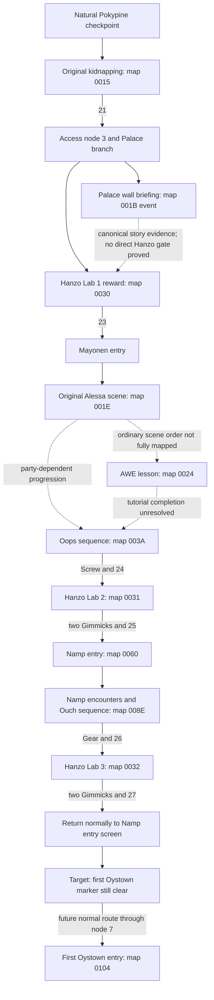

# Pre-Oystown progression and checkpoint investigation

Date: 2026-10-13. Documentation and bounded read-only static analysis only.
No ROM, RAM, save or checkpoint was modified; no emulator/Ghidra was operated.
**The target checkpoint is not constructed, and full-state construction is not
yet justified.** The core route, several original completion paths, seven core
Gimmicks and a flag gating an Oystown introductory sequence are now substantiated. Complete optional
content, scene side effects, tutorial completion and save/reload remain unresolved.

## Sources, scope and evidence levels

Read-first sources: AGENTS.md; modding plan; all three session handoffs (latest 3);
Hanzo progression, Oystown readiness, AWE report/evidence, recruitment report;
memory map/symbols and original event/character/acquisition analysis. Existing
historical claims were checked at their named addresses rather than accepted as
new confirmation. The AWE report now records the user's successful charge-only
trial and the exact limits on consumption/persistence inference.

New read-only tool: [tools/analyze/pre_oystown_progression.py](../tools/analyze/pre_oystown_progression.py).
Reproduce with `python -B tools/analyze/pre_oystown_progression.py`.
[Machine-readable evidence](pre_oystown_progression_evidence.json) records 14 named
script intervals, 16 native windows, selected map records/links and arrivals,
scope hashes and protected-file inventories. Linear command boundaries use the
actual argument tables; they do not prove all paths execute or certify transitive
callback effects. The Oystown setup inventory stops before a command crossing its
explicit limit; the report does not pretend it is a complete NPC/script audit.
Native windows are byte-identical between Japanese and English baselines. Dialogue
pointer relocation can make script windows differ; English script bytes are the
implementation reference, with original address mapping retained.

Bus addresses map to file offsets by subtracting 0x08000000. RAM has no ROM file
offset. Function names are research descriptions, not recovered developer symbols.

- **User-confirmed runtime:** supplied recruitment/AWE observations and earlier
  natural checkpoint/route observations with their recorded provenance.
- **Confirmed static:** exact bytes, table links and bounded load/store operations.
- **Probable:** story/event identity or intended state meaning supported by text
  and script placement but not newly executed.
- **Candidate:** proposed strategy or incomplete availability inference.
- **Unconfirmed/untested:** missing semantic, transitive or runtime evidence.

## Exact target and starting-state limits

The requested final location is the **entry screen of Namp Lagoon, map 0x0060**,
with ordinary movement/overworld access, DeMille–Alessa initialized, all normally
obtainable pre-Oystown Gimmicks/equipment, functional preferably full AWE, a
logically completed tutorial, completed mandatory story, and **first Oystown
arrival still pending**. The original Binky exchange must remain intact.

This means a **return to Namp's entry screen after its boss and Hanzo Lab 3**,
not simply the first Namp arrival: route 6→7 requires flag 26 and 7→8 requires
27, whose original setters occur in those later events. First Namp arrival alone
does not make the normal Oystown route available. A direct Namp→Oystown edge was
not found in the reviewed node switches; the route is through node 7.

Earliest reliably documented natural anchor relevant here is root
`map_pokypine.ss0`, SHA-256
`1079f53c58187342856f405d9c18bc7d96cfc9ea7ba9c224569d7914d9841eb2`:
overworld node 1, field map retained as 0008, DeMille only, route 21 clear (handoff
2 / Hanzo report). Its ordinary story must continue through original events.
Root `entry-stop.ss0` is a protected **isolated route-unlock experiment** at Hanzo
Lab 1; it is not independently established as a canonically progressed story
anchor. Do not equate successful party/AWE tests on its derivative with complete
preceding kidnapping or palace-briefing state.

## Canonical route and dependency model

Node names come from `ta_menus_eng.txt`, `BLOCKFIXED 49F61C`, rows 00–10. Movement
checks are implemented by node switch routines using 0x080889BC (main flag reader
wrapper). Switch tables are data, not instructions.

| Route | Required flag / native check | Original setter identified | Confidence |
| --- | --- | --- | --- |
| Pokypine node 1 → Hanzo Lab 1 node 3 | 21, 0x08089100/0x0808911E | Kidnapping 0x08125867; palace briefing also 0x0810D49E | Confirmed static; route unlock additionally historical runtime evidence |
| Lab 1 node 3 → Palace node 2, up | 21, 0x08088E80 | Same flag 21 | Confirmed static; reverse Palace→Lab1 requires **22**, asymmetry preserved |
| Palace node 2 → Lab 1 node 3, down | 22, 0x08088FC0 | Briefing 0x0810D4A2 | Confirmed static |
| Lab 1 node 3 → Mayonen node 4, right | 23, 0x08089210/16 | First Hanzo reward 0x0810D6C8 | Confirmed static; reward scenario runtime-validated |
| Mayonen node 4 → Hanzo Lab 2 node 5, up | 24, 0x08088E98 | Mayonen boss-scene tail 0x0810ECD6 | Confirmed static gate/write; full boss outcome path untested |
| Lab 2 node 5 → Namp node 6, up | 25, 0x08088EB0 | Original Lab2 event 0x08111E7C | Confirmed static |
| Namp node 6 → Lab 3 node 7, left | 26, 0x08089134 | Namp boss-scene tail 0x08116590 | Confirmed static |
| Lab 3 node 7 → Oystown node 8, left | 27, 0x0808914C | Original Lab3 event 0x08112213 | Confirmed static |
| Namp node 6 → Lab2 node 5, down | 25, 0x08088FD8 | Original Lab2 event | Confirmed static normal return access |
| Lab3 node 7 → Namp node 6, down | 26, 0x08088FF0 | Original Namp boss event | Confirmed static return access for target placement |
| Oystown node 8 ↔ Lab4 node 9 | 28, 0x08089164 / 0x08089244 | Natural producer not investigated here | Confirmed static gate, **not needed** for incoming route through Lab3 |

Normal progression requires earned route flags **21–27** along this route (22
for the Palace branch/return). At a Namp target reached after Lab3, 23–27 should
already be earned. These are **consequences to validate**, not a list of bits to
inject. Do not set 28 to enable the wrong incoming route. No clearing of unknown
late flags is justified merely by their numeric ordering.



Solid route/completion edges have direct gate/write support; dotted edges preserve
unresolved narrative/scene ordering rather than inventing prerequisites. The
Palace briefing is **Probable canonical story content**, but Hanzo's first reward
does not directly check its completion marker in the documented local selector.
This distinction matters: mechanically reaching Mayonen does not prove the wall
briefing occurred. The graph is a core model, not a complete encounter/sidequest DAG.

## Significant original events and state effects

| Event / script and map | Conditions read | Writes / side effects / evidence | Confidence and missing proof |
| --- | --- | --- | --- |
| Pasaran kidnapping, map **0015**; default pointer 0x08159B94 → **0x081251C6** | Entry tests 16E and 112 at 0x081251C6/CE | Sets 112 at 0x081251D6; 16F at 0x081255E0, 170 at 0x08125608; `FE 43 07 1C` at 0x0812585F; sets 16E and route21 at 0x08125863/67; subsequent restoration/actor/transition commands remain. Text A65–A75 names Brikky/Grikky, Pasaran and Abira. | Confirmed static links/commands; kidnapping/completion labels Probable. Full meanings of 112/16F/170 and success/exit effects unresolved. Do not reproduce only 21. |
| Palace wall briefing, map **001B**; secondary event pointer **0x08159BD4 → 0x0810D1F0** | Guards include 8F, 8D, 209, 20F (Hanzo report); retained event bytes corroborate | FD4D at entry sets byte selector00=03; sets 21,22,209,21E at 0x0810D49E/A2/A6/AA. Messages 574–583 explain six Toy Parts, palace wall and Mayonen/Oops. | Confirmed static pointer/writes; full story ordering/effects Probable. **Corrects historical pointer-slot claim 0x08159BD0**, which contains FF metadata, not the script pointer. |
| Hanzo Lab1, map0030; 0x08159D1C → 0x0810D4C0 | Persistent byte selector3D <12 hex; flags96/8D/20A clear select first reward | Original Erupter parameters at 0x0810D693/698; shared reward 0x08124B33; route23 at 0x0810D6C8 and claimed marker20A at 0x0810D6CC | Confirmed static; Erupter, event finish and wrapper's added party initialization User-confirmed runtime. Wrapper omits original Alessa story effects. |
| Alessa original encounter, map001E; secondary pointer 0x08159BEC → 0x081271E9 | Entry branches using 114,105,108,1FE; scene tests 117 at 0x081272D1; additional local flags300/301 | `FE 43 0E 1C` at 0x08127322, then 117 at 0x08127326, FE49 at 0x0812732A, FE53 6B at 0x0812732C; scene toggles 300/301 and processes actors at its end; dialogue AB1 names becoming a friend | Confirmed static sequence; robot encounter/story meaning Probable. Recruitment/acquisition handlers validated by wrapper, **entire scene not runtime-validated**. All guard meanings/context effects not established. |
| AWE tutorial, map **0024**; default pointer **0x08159C5C → 0x08128D5A** | 171; skip-path checks 1FE/B7 | Sets171 before lesson, scripted battle at 0x08128E77, audio/camera/actor controls, final main return0x08128F14. See AWE report. | Confirmed static linkage; new map association. Completion equivalence unresolved despite User-confirmed runtime ordinary AWE. |
| Oops / Mayonen boss sequence, map003A; default0x0815A04C → 0x0810E53C | Numerous actor/event branches; complete battle prerequisites not enumerated | Flags228 at0x0810E90E; battle `FE43 10 1D` at0x0810EA8A; flag227 at0x0810EA90; ToyPart ID1 passed to shared0x08124E4A/0x08124EFC; flag271 at0x0810EC13 before spy-data choice; route24 at0x0810ECD6; return/transition to Mayonen map0048 | Confirmed static commands; Oops identity Probable from 5CC–5D9 pointer/text evidence. 271 is **not proved “video watched”**, because written before choice. Battle/quest prerequisites and cash/restoration/callback effects unresolved. |
| Hanzo Lab2, interior0031; default0x08159D24 → 0x08111CE6; exterior arrival00DE | Entry tests claimed marker229 | Rewards at0x08111E40/45 (param0088, packed0029), 0x08111E54/59 (0088,005F), calls shared reward; route25 at0x08111E7C, claimed229 at0x08111E80; preceding actor/item/minigame calls | Confirmed static; names/ownership below; full event context and ToyPart-handling prerequisites unresolved. |
| Ouch / Namp boss sequence, map008E; default0x0815A384 → 0x08116044 | Actor/quest branches; full ticket, concert, disco-pearl prerequisites not mapped | Flag25A at0x08116068; battle `FE43 1F 1D` at0x08116226; ToyPart ID2 via shared reward; flag272 at0x0811646E before spy-data choice; 257 at0x08116588; FD4D selector3C=01 at0x0811658C; route26 at0x08116590; transition to map005F afterwards | Confirmed static; Ouch identity Probable from messages741–754. The first route completion does **not** return directly to map0060; later normal return needed. Complete concert chain and variable3C meaning unresolved. |
| Hanzo Lab3, interior0032; default0x08159D2C → 0x08112090; exterior00DF | Entry tests claimed22A | Rewards0x081121D8/DD (0083,001D),0x081121EC/F1 (0087,0047); route27 at0x08112213, claimed22A at0x08112217; original map return to00DF | Confirmed static; reward names/ownership below; event context/side effects untested. |
| Namp entry / setup | Node6 entry script0x08130E34 → map0060; setup0x081148EB | Numerous FD54 second-bank clears; FD4D selector00=05 at0x0811499F; FE89/FD7D end | Confirmed static bytes; movement/exit and stable actor setup untested. |
| Oystown incoming/setup/default | Node8 arrival0x08130E4E, setup0x08102491, map0104 default0x0810C67A via0x0815A9BC | Setup/default test1C0/1F4; when appropriate invoke **0x081084CA**. That block tests1F4 and sets it at0x081086F0 near its end; actors/dialogue and map transitions precede this write. | Confirmed static checks/write; first-arrival scene interpretation Probable from incoming/default references. Full dispatch/side effects and original Binky NPC eligibility unresolved. |

Map-record formula: original bus0x0862D3E4 + mapID*0x1C, event-table pointer at
record+0x10; table entries contain script pointers **and metadata**, not an array
of interchangeable pointers. Map003A's actual table bus is **0x0815A04C** (the
event-table value in evidence is authoritative). No table slot was overwritten.

FE43 native 0x080250E4–0x0802514C builds battle descriptor
0x084559B4+(first argument−1)*0x28, supplies the second argument as a battle-mode
parameter and calls normal transition 0x0802C2B4. This confirms a battle request,
not the full victory/defeat control contract. Marker writes following a battle
must be interpreted in its original success context, never as replacement for it.

## Persistent versus local/transient state

| Field | Verified representation | Proposed final treatment / confidence |
| --- | --- | --- |
| Main bit-bank base0x030032E7 | FD49/FD35 and main helpers use flagID>>3 and mask1<<(ID&7); legacy saved extent covers IDs0–2FF | Confirmed static arithmetic. Validate earned story markers; do not fill the bank. |
| Route23–27 | Byte0x030032EB masks08,10,20,40,80 | Confirmed static gates/setters; all earned before target. Not sufficient alone. |
| Route28 | Byte0x030032EC mask01 | Confirmed static; incoming route throughLab3 does not need it. Preserve legitimate state; no speculative edit. |
| First Oystown marker1F4 | Byte0x03003325 mask10 | Confirmed static test/set; **must remain clear** for the intended unconsumed original scene. Clearing it after visiting would not undo scene side effects. |
| Alessa scene117 | Byte0x03003309 mask80 | Confirmed static; expected earned through original encounter. Do not set it solely to mask wrapper conflict. |
| AWE lesson171 | Byte0x03003315 mask02 | Confirmed static entry marker, **not complete tutorial proof**. |
| Main flags300/301 | Accessor arithmetic would address0x03003347 bits01/02, outside legacy 96-byte saved range | Original scene commands confirmed; serialization/persistence and role unresolved. Scene-local interpretation Candidate. Do not inject them. |
| FD4D byte bank0x03003287 | Native0x0802A004 writes bank+first-byte selector, second byte value | Confirmed static; legacy report confirms bank save/load. Ouch selector3C=01 targets0x030032C3; complete meaning/write graph unresolved. |
| Byte selector3D =0x030032C4 | First Hanzo compares<12 hex; other event-stage writers documented historically | Confirmed static layout; do not invent a sequential “story stage” number. |
| Toy Parts at0x03001AB6 | FE52 native0x080255EC sets a bit using operand index; shared reward converts ID1→FE52 00, ID2→FE52 01 | Confirmed static. Screw/Gear correspond to low bits01/02; expected earned before Lab3. Other bits not mapped as independent optional acquisitions. |
| FD54's **separate** bit bank0x03003107 | Native0x0802770C→0x0806B0B8→generic clear0x08069FBC | Confirmed static distinct bank. Setup arguments03xx/05xx/08xx are not main-story flag IDs to set. Full lifecycle/save provenance Unconfirmed. |
| Map transition request0x03001930 | FE7C/7D stores destination at+6, arrival bytes at+2/+3/+4, additional bytes+0/+1 forFE7D; callback pointer into0x0300194C, calls0x0802C1F0 | Confirmed static. Temporary loader request, not a substitute for a complete stable checkpoint. Do not inject request/cursor/control flags. |
| Interpreter/battle/camera/control state | Context bank0x03003AD4, battle records0x03000938, active action/scheduler fields | Transient by role, Confirmed static usage. Let normal game machinery create/retire these; no copying arbitrary runtime memory. |

Equipment, key items, money, actors, route/quest markers and byte variables can
all change in these scenes. A row listing one known marker does not certify the
complete state transition. Any future transformation must reproduce an observed
normal outcome and preserve adjacent bits/fields, not imitate numeric flag order.

## Core Gimmicks and optional-content gap

Names/ID mapping: `ta_menus_eng.txt` BLOCKFIXED490420 and RESTRUCT62C250, 50 rows;
runtime ID = zero-based text row+1. Packed reward bits6–7 select character; low6
bits select ID. Shared0x08124B33 eventually executes FE54 and native acquisition
0x0802927C→0x0806ADA0. Inventory count is character+7, entries at+8, stride3:
`ID, acquisition difficulty, upgrade`. Normal grant also initializes usage bytes
and empty equipped slots. Difficulty comes from0x0300196E; do not assume every
later acquisition must be synthetic `ID 01 00` without checking actual state.

| Gimmick | Runtime ID / owner | Acquisition evidence / availability | Classification |
| --- | --- | --- | --- |
| Gear-Yo | 01 / DeMille | Present in earlier initial/natural checkpoints and tests; original grant-site not newly mapped | User-confirmed runtime presence; early availability Confirmed; exact original acquisition event unresolved here |
| Erupter | 1B / DeMille | HanzoLab1, map0030, operand0x0810D698; original route23 completion follows | User-confirmed runtime, Confirmed static; core canonical reward |
| Pop Horn | 2B / Alessa | Original map001E FE53 6B at0x0812732C; wrapper grant at0x08800002 | User-confirmed runtime; normal scene acquisition Confirmed static; core recruitment reward |
| Dojo Pup | 29 / DeMille | Lab2 map0031 operand0x08111E45 `FD0B 1C 2900`, shared call follows | Confirmed static core route reward; naturally obtaining it here not yet tested. Earlier Lab1 replacement experiment is a separate artificial acquisition. |
| Puffer | 1F / Alessa | Lab2 operand0x08111E59 packed5F | Confirmed static core route reward, runtime untested |
| SneaKar | 1D / DeMille | Lab3 operand0x081121DD packed1D | Confirmed static core route reward, runtime untested |
| RabiShoes | 07 / Alessa | Lab3 operand0x081121F1 packed47 | Confirmed static core route reward, runtime untested |

These are **seven substantiated core Gimmicks, not a proved complete pre-Oystown
inventory**. With these alone and no duplicates, counts would be DeMille4 /
Alessa3; optional content could increase them. Shop stock/gates, NPC quests,
treasure/battle rewards and other normally obtainable early Gimmicks are not
exhaustively classified. The full supported50-ID list is not an availability list.
No optional candidate is approved for granting solely because its ID/name exists.
Equipment/clothes and ordinary items likewise need a stage-specific acquisition
audit. The low ToyPart bits are separate from Gimmick inventory.

## Namp arrival and preserving Oystown first visit

Arrival selection0x08088AF0 uses switch table0x08088B04. Verified scripts:

| Node | Script | Destination / arrival operand / callback |
| --- | --- | --- |
| 3 Lab1 | 0x08130E09 | FE7D map002F, `04 08 08 00 80`, pointer sentinel1 |
| 4 Mayonen | 0x08130E18 | FE7D map0048, `1B 06 00 08 86`, pointer sentinel1 |
| 5 Lab2 | 0x08130E27 | FE7C map00DE, `03 08 80`, sentinel1 |
| 6 Namp | **0x08130E34** | FE7C map**0060**, **`07 08 80`**, callback**0x081148EB** |
| 7 Lab3 | 0x08130E41 | FE7C map00DF, `01 05 82`, sentinel1 |
| 8 Oystown | **0x08130E4E** | FE7D map**0104**, `01 07 00 01 82`, callback**0x08102491** |

The loader preserves full map/pointer values and explicitly calls normal map
transition logic. Arrival bytes' destination fields are confirmed; coordinate
units, collision placement and actual safe movement/overworld exit are untested.
Do not turn these bytes into guessed live coordinates or serialize a half-loaded
map. At final placement, use normal return traversal into0060 and stop only after
map loading, event threads and control locks retire.

Oystown map0104 default0x0810C67A and incoming setup both branch on1C0/1F4 and
reference0x081084CA. That scene tests1F4 at its start and writes it at0x081086F0.
Preserve **1F4 clear**, but do not pretend it is the only first-visit condition.
Meaning of1C0, actor positions, callbacks and repeated-visit behavior need further
analysis/manual evidence. Do not enter Oystown during checkpoint preparation.

Original Binky exchange message pointers0x081086E3 and0x08107E9A were previously
identified; the current first-entry span contains one of those dialogue references.
This is a useful connection, not proof that the complete exchange is triggered,
available or initialized solely by first arrival. NPC stock/exhaustion, party,
charge and progression eligibility remain an independent investigation. Its
scripts, gate and commands must remain unchanged.

Semantic limit: the dialogue in this incoming sequence includes the wandering
merchant's AWE/Binky introduction (messages4A0–4AB). Accordingly, 1F4 is a
**confirmed introductory-sequence guard/setter**, but identifying it as the sole
global “Oystown has been visited” marker would overstate the evidence. Keep this
introduction pending in the proposed target and investigate other first-arrival
effects separately; do not use its value alone to certify town history.

## Strategy comparison and recommendation

| Strategy | Advantages / risks | Evidence-supported decision |
| --- | --- | --- |
| A: controlled original event execution | Complex recruitment/acquisition operations retain original routines; wrapper proves one small command sequence. Full boss/story scenes require their actors, map, child events and battle-success context, not merely a valid FD2F return slot. | Candidate only for separately mapped atomic events. Do not route entire unrelated scenes through Hanzo. |
| B: persistent-state transformation | Can be deterministic for measured simple fields, as charge-only AWE demonstrated. Complete story transform presently lacks the full normal-state diff, serialization/copyback contract, quest/item/actor effects and optional inventory. | Not sufficient for a complete checkpoint. No bulk flag/variable/inventory edit plan is approved. |
| C: hybrid with a naturally progressed control | Establish original story/party/tutorial/acquisition outcomes via normal events, then supplement only independently validated simple fields (e.g. final charge40), with offline diff and save/reload verification. | **Recommended**, Probable overall safety; preserves evidence and limits rather than convenience. Needs further mapping/testing before construction. |

The successful early recruitment ROM is a **unit experiment, not a canonical
story base**. Its wrapper initializes Alessa/PopHorn but omits117 and the original
scene's battle, actor, flag300/301 and other effects. At original0x0812732A,
FE49 with Alessa already present can initialize companion2 or3 instead; that
handler behavior is Confirmed static. Whether a particular later path reaches
that instruction depends on the unresolved scene guards. Do not test ordinary
continuation through that scene blindly and do not “fix” it by setting117.

A fresh original English control with natural recruitment is the preferred
reference for canonical progression. If a future derivative is justified, preserve
the verified wrapper ROM/environment, create a separate output, hash-gate its
16 MiB source and account for its existing redirect and EOF reservation. Do not
silently stack music, Dojo Pup, Gear-Yo balance or story shortcuts.

## Incremental milestones and exact next experiment

For every future milestone: separate authorization before execution/edits, fresh
isolated working copies with source/output hashes, `loadStateExtdata=9`, no rewind,
empty patch/cheat paths, new capture/save names, and rollback by discarding the
working branch—not by reversing a flag after events have run. Never overwrite a
protected ROM/environment/save/checkpoint. Request debugger actions individually.

| Milestone | Prerequisites and proposed work | Expected observation / manual validation | Stop conditions |
| --- | --- | --- | --- |
| 1. Natural early-story reference | English baseline + natural Pokypine control. Run original kidnapping/briefing normally in a future authorized session; inspect112/16F/170/16E,21/22,209/21E and any item/variable changes. No synthetic route edit. | Original battle/scene completes; Pasaran story and Palace briefing consistent; normal routes to Lab1/Mayonen work. Read one field at a time at stable boundaries. | Unexpected scene branch, replay, battle result, party, actor or route behavior; do not add flags to advance. |
| 2. Canonical Alessa/tutor reference | Original early story complete, natural Mayonen access; no early wrapper recruitment on this branch. Execute original001E encounter, then natural0024 lesson when reached. |31 membership/PopHorn plus legitimate117 and actor cleanup; tutorial exit and171 measured with other changed persistent fields; ordinary AWE thereafter. | Wrong companion, duplicate grant, scene does not exit normally, unexplained persistent changes; do not fake lesson completion. |
| 3. Oops and Lab2 outcomes | Valid Mayonen party/scene/quest state. Original boss success and Lab2 interaction. | Screw acquired, legitimate24/25 and229; DojoPup/Puffer through normal inventory routine; travel toNamp. | Boss skip/defeat discrepancy, missing key item, wrong reward, route-only success without state coherence. |
| 4. Namp/Ouch and Lab3 outcomes | Stable normal Namp arrival and original ticket/concert/disco-pearl chain investigated. Execute original events and Lab3. | Gear,26/27,22A; SneaKar/RabiShoes; normal return towardNamp. | Missing concert prerequisite, malformed actor/transport state, reward duplication, premature Oystown entry. |
| 5. Optional inventory/equipment completeness | Map every early NPC/shop/treasure/sidequest gate against above stage; no earlier milestone declares completeness. | Enumerated mandatory/optional availability list, ownership, initialized entries and legitimately obtained equipment; representative menu/battle checks. | Any source has unknown stage/owner/gate; do not grant it speculatively. |
| 6. Final placement/charge and persistence | Naturally completed reference throughLab3; Oystown1F4 stillclear; complete inventory/tutorial evidence; normal return to0060. | Normal movement/overworld, target location; separately authorized charge-only40 if desired; new disposable battery save/reload and next ordinary battle preserve consistency. | Half-loaded map, control locks, consumed firstvisit, persistence mismatch, unknown quest state. No telemetry/teleport repair. |
| 7. First Oystown/exchange observation | Only after a verified reference checkpoint exists and further runtime testing is authorized. Duplicate it for test; keep target source unconsumed. | Original first entry executes and1F4 changes naturally; investigate exchange one condition at a time. | Unexpected pre-consumption, missing actors, altered original behavior. |

**Exact next safe experiment:** establish the original early-story completion
contract at map0015, beginning from a disposable copy of the natural Pokypine
checkpoint on the **unmodified English baseline**. The narrow unresolved dependency
is which intermediate112/16F/170, battle/actor and persistent-variable effects
are required alongside the known16E/21 setters. A raw route21 edit already proved
access; it cannot answer this story question.

In a **future authorized user-operated session**, after configuring/pausing that
isolated control, the single first debugger action would be:

```text
break 0x0806AEA0
```

This is the normal main-flag setter wrapper, not a memory edit. Report breakpoint
installation before any next action. At subsequent manually advanced stops,
inspect the utility flag ID at0x030018C0 one action at a time to identify the
expected original flag writes; a first hit may be a different flag. Do not
automatically continue through unfamiliar hits or execute a batch script.
An observed setter alone is not scene completion: capture normal battle outcome,
stable scene exit and subsequent route/quest behavior separately.

## Unresolved dependencies and authorization decision

The complete pre-Oystown state cannot yet be reconstructed from static evidence
alone. Missing: full early kidnapping/briefing effect contract; original Alessa
scene guards/cleanup; completed tutorial equivalence; Oops success effects and
Lab2 context; Namp ticket/concert/disco-pearl and Ouch dependencies; Lab3 side
effects; optional Gimmick/equipment/shop availability; stable Namp arrival/exit;
all Oystown first-entry guards; physical save serialization and save/reload.

There is sufficient evidence to authorize the **first isolated natural-event
observation milestone**, but **not a checkpoint-construction/state-transformation
experiment** that claims story equivalence. No guessed modification is proposed.
Protected-file audit: **81 current ROM/save/checkpoint files**, identical before/
after inventory and SHA-256. English/Japanese/recruitment ROMs and existing states
are preserved. Files changed: AWE report (runtime evidence appended); this new
report; new read-only analysis tool; new machine-readable evidence file. Existing
research findings are preserved; no old report/evidence or runtime output was
replaced. Work ends here.
